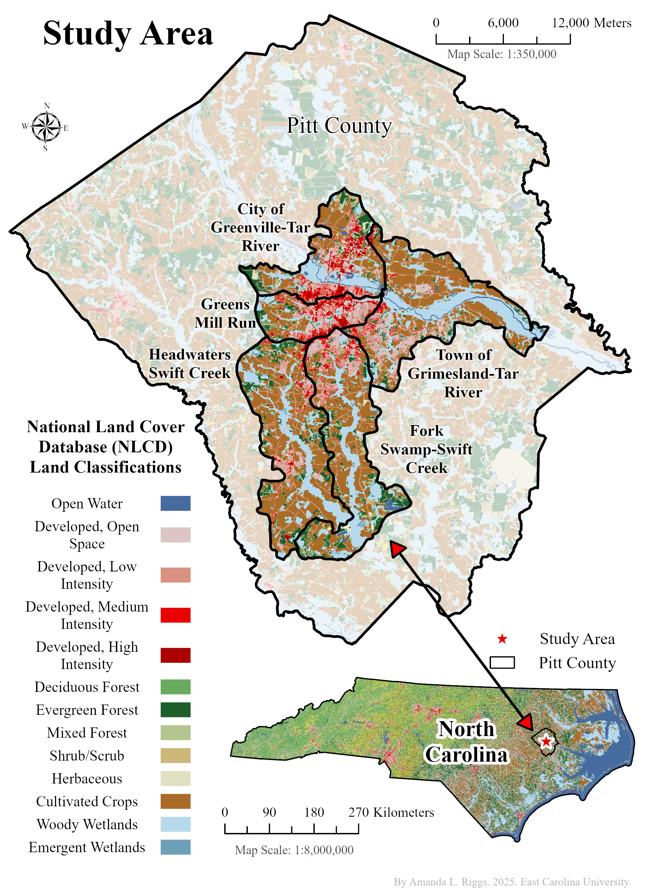
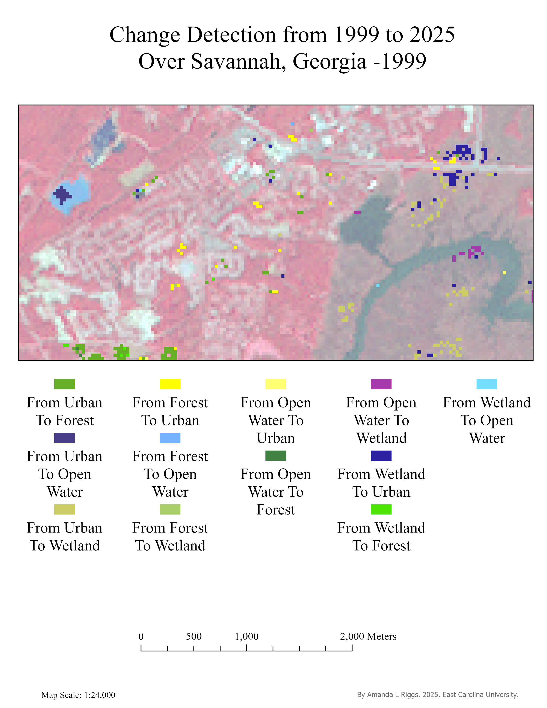

# Amanda Riggs | Professional Portfolio

[View résumé (PDF)](Amanda_Riggs_Professional_Resume.pdf)

**Research · Data Analysis · Programming · Automation · Visual Communication**

I bring together research, analytical thinking, and technical tools to turn complex information into understandable results. My work includes academic research at East Carolina University, independent demonstrations, and GeoSite Intel project materials.

This collection shows how I approach a question, organize and analyze information, build repeatable workflows, and explain the results through reports, presentations, and maps. Geospatial work is one part of that broader approach. Additional undergraduate and independent work will be added over time.

## Start with These Three Projects

| Project | What to look for | Open |
|---|---|---|
| **Fairview property intelligence** | Turning environmental, terrain, and drainage information into a structured screening report | [View report (PDF)](Fairview_Property_Intelligence_Report.pdf) |
| **Python order validation** | Checking messy records, separating exceptions, and producing useful summaries | [View demo guide (text)](Order_Validation_README.txt) · [Download Python script (.py)](process_demo_orders.py) |
| **Savannah land-cover analysis** | Comparing imagery from two periods and communicating classification and change results | [View report (PDF)](Savannah_Land_Cover_Analysis_Report.pdf) |

PDFs, images, and text files usually open in your browser. PowerPoint presentations, Python scripts, and CSV files may download or prompt you to save them, depending on your browser settings.

For project context, contributions, methods, outputs, and limitations, see the [Project Guide](PROJECT_GUIDE.md).

## Skills in Practice

| Area | Examples in this portfolio |
|---|---|
| Research and evidence synthesis | Property screening, thesis-related work, environmental analysis |
| Programming and automation | Python CSV validation; ArcGIS Pro and ArcPy preprocessing workflows |
| Data analysis and quality review | Record validation, image classification, accuracy assessment, constraint overlays |
| Technical communication | Analytical reports, workflow documentation, teaching presentations |
| Visual communication | Thematic maps, study-area context, comparative results |

## Selected Visuals

### Research context: Pitt County, North Carolina

[](Thesis_Pitt_County_Study_Area.jpg)

[View study-area map (image)](Thesis_Pitt_County_Study_Area.jpg)

### Analytical communication: Savannah land-cover change

[](Savannah_Land_Cover_Analysis_Report.pdf)

[View Savannah analysis report (PDF)](Savannah_Land_Cover_Analysis_Report.pdf)

Select an image or its labeled link to open the map or supporting report.

## Explore the Collection

- [Applied research and property screening](PROJECT_GUIDE.md#applied-research-and-property-screening)
- [Python and business data automation](PROJECT_GUIDE.md#python-and-business-data-automation)
- [Geoprocessing automation and presentations](PROJECT_GUIDE.md#geoprocessing-automation-and-presentations)
- [Thesis research and environmental communication](PROJECT_GUIDE.md#thesis-research-and-environmental-communication)
- [Savannah land-cover classification and change](PROJECT_GUIDE.md#savannah-land-cover-classification-and-change)
- [Hydrologic terrain processing](PROJECT_GUIDE.md#hydrologic-terrain-processing)
- [Buncombe flood-risk analysis](PROJECT_GUIDE.md#buncombe-flood-risk-analysis)
- [Cartography and LiDAR](PROJECT_GUIDE.md#cartography-and-lidar)

## Run the Python Demonstration

The example uses fictional sample orders and the Python standard library. With Python 3 installed, run this command from the repository folder:

```bash
python process_demo_orders.py
```

The script reads `sample_orders.csv` and regenerates `clean_orders.csv`, `review_required.csv`, and `customer_summary.csv`. It leaves the input unchanged. See the [View demo guide (text)](Order_Validation_README.txt) for details.

## Scope and Attribution

Academic work and independent demonstrations are identified in the project guide. GeoSite Intel reports are presented as screening and communication samples; inclusion does not imply a commissioned client engagement. Model outputs and desktop screening are interpreted within the limitations described in their source reports.

This repository contains selected deliverables. Full GIS datasets, project environments, and intermediate files are outside its scope. Reproducing GIS analyses may require specialized software, licenses, and external data. Original source credits and references remain in the project materials.

## Copyright and Reuse

Unless otherwise noted, original materials are © 2026 Amanda Riggs. All rights reserved. No additional reuse permission is granted unless a project includes a separate license. Existing project-specific notices apply. Third-party datasets, software, imagery, and other resources remain subject to their respective licenses and attribution requirements.

